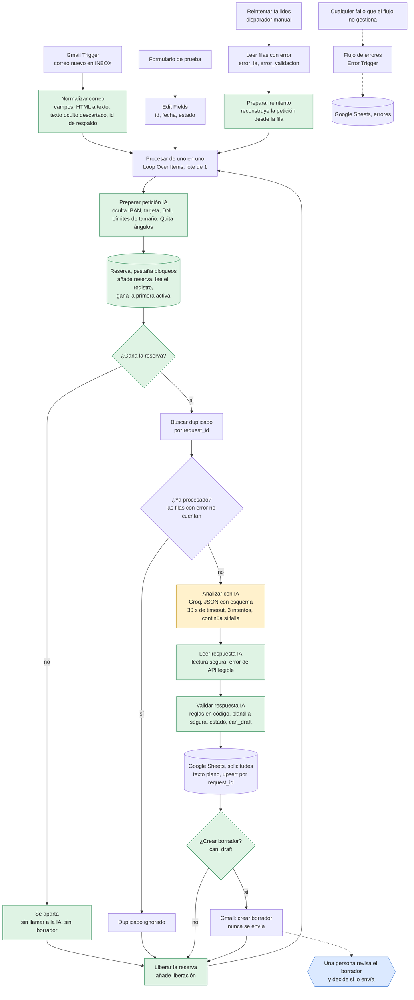

# LeadFlow AI

[](https://github.com/lararaul439-ctrl/leadflow-ai/actions/workflows/ci.yml) [](LICENSE)

[English](README.md) · [Español](README.es.md)

LeadFlow AI es un workflow de n8n con una persona en el circuito que convierte los correos entrantes de clientes en solicitudes clasificadas y registradas, con un borrador de respuesta esperando aprobación. Lee cada correo, lo clasifica con un modelo de lenguaje, lo registra en Google Sheets y deja un borrador en Gmail. **No envía ningún correo por sí solo.**

Construido con n8n, Gmail, Google Sheets y un modelo de lenguaje por API. Las reglas de negocio viven en el código y no en el prompt, y el proyecto incluye una batería de pruebas automáticas y dos revisiones técnicas documentadas.

> **Estado:** implementación de referencia probada. Todos los datos de este repositorio y de las pruebas son ficticios, y nada se ha usado con clientes reales. Ver [Estado y límites](#estado-y-límites).

## El problema

Las empresas reciben correos comerciales que alguien tiene que leer, clasificar, anotar y contestar a mano. Es trabajo repetitivo en el que se pierden oportunidades. LeadFlow AI automatiza la lectura, la clasificación y el registro, y prepara una respuesta, pero deja la decisión de enviarla a una persona.

## Para quién es

- Equipos comerciales y de atención al cliente que reciben solicitudes por correo y quieren clasificarlas antes, sin perder el control de lo que se envía.
- Equipos que evalúan cómo meter un modelo de lenguaje en un proceso de negocio con seguridad: el repositorio muestra el diseño, las pruebas y los límites.
- Desarrolladores y especialistas en automatización que quieren un ejemplo trabajado de validación, control de concurrencia y pruebas en n8n.

## Qué hace

1. Detecta correos nuevos en Gmail (o toma una solicitud de un formulario de pruebas, o una fallida para reintentarla).
2. Limpia el correo: quita caracteres de control, invisibles y parecidos a otras letras, descarta el texto oculto del HTML, limita su tamaño, oculta números de tarjeta, IBAN y documentos de identidad, y marca lo raro.
3. Reserva el correo en un registro compartido, para que dos ejecuciones que empiezan a la vez no puedan crear las dos un borrador.
4. Comprueba si ese correo ya estaba registrado.
5. Pide a un modelo de lenguaje un JSON con categoría, prioridad, datos del cliente, información que falta, resumen y borrador de respuesta.
6. Valida la respuesta con reglas en código que no dependen de la IA. Si el borrador muestra cualquier señal de riesgo (una cifra que no está en el correo, una promesa, un enlace, hablar de pagos), se sustituye por una respuesta de cortesía fija.
7. Guarda la solicitud en Google Sheets (como texto plano, una fila por correo) con su estado, los datos del cliente extraídos, si requiere revisión humana y los avisos de validación.
8. Crea un borrador en Gmail, solo cuando el resultado es válido y tiene destinatario.
9. Si falla el paso de IA, guarda el correo con el motivo y sigue; una entrada manual reintenta esas filas.



En naranja, el único paso que usa el modelo de lenguaje. En verde, los pasos de código propio. En azul, la decisión humana. Las decisiones de diseño, nodo a nodo, están en [docs/arquitectura.md](docs/arquitectura.md).

## En acción

### Ejemplo de ejecución

Llega un correo ficticio con datos de pago dentro:

> **Asunto:** PRUEBA enmascarado IBAN (datos ficticios)
> **Mensaje:** Hola, quiero un presupuesto de 50 tazas. Para la factura: IBAN GB29 NWBK 6016 1331 9268 19, otro IBAN NL91 ABNA 0417 1643 00 y mi DNI 12345678-Z. Gracias.

Esta es la fila que quedó en la hoja (una ejecución real, la #103 de la v1.1, con datos ficticios; desde la v1.2 la fila lleva además los datos del cliente extraídos):

| Columna | Valor |
|---|---|
| `body` | Hola, quiero un presupuesto de 50 tazas. Para la factura: IBAN **[IBAN oculto]**, otro IBAN **[IBAN oculto]** y mi DNI **[documento oculto]**. Gracias. |
| `category` / `priority` | `presupuesto` / `media` |
| `status` | `incompleta` (el modelo pidió dirección de entrega y datos de contacto) |
| `human_review_required` | `sí` |
| `validation_flags` | El correo contiene datos de pago o credenciales \| El correo contiene un documento de identidad (ocultado) \| Información incompleta |

Los números no llegaron al modelo ni a la hoja, y se creó un **borrador** en Gmail pidiendo los datos que faltan, para que lo lea una persona. No se envió nada.

### Ilustraciones

Las cuatro imágenes de abajo son **reconstrucciones, no capturas de pantalla**. Están dibujadas a partir de los datos de una ejecución real en la instancia de pruebas (correos ficticios, no se envió nada) y del archivo exportado del workflow, y cada una lo dice en su pie. Todavía no se incluyen capturas reales ni grabación. Las imágenes están en inglés.

**Un correo entra, una solicitud queda registrada.** El IBAN y el documento de identidad se ocultan antes del modelo y antes de la hoja.


**Solo borradores.** El workflow prepara una respuesta; una persona decide si la envía.


**Un correo hostil se trata como dato.** El código lo marca, fija la prioridad, fuerza la revisión humana y cambia el borrador por una respuesta fija.


**El workflow**, dibujado a partir de `workflows/leadflow-ai.json`.


## Salvaguardas

| Riesgo | Cómo se aborda |
|---|---|
| El correo intenta dar órdenes a la IA | El correo se trata como dato no confiable: va dentro de una etiqueta, se le quitan todos los ángulos para que no pueda cerrarla y las instrucciones prohíben obedecerlo. Además, el código detecta frases típicas en español e inglés, marca el correo para revisión y fija él mismo la prioridad, para que «promete entrega mañana» no pueda subirla. La inyección de instrucciones se mitiga, no se elimina; 119 pruebas adversariales la cubren. |
| El texto esconde sus órdenes | Se quitan los caracteres invisibles y de control de dirección, las letras parecidas y de ancho completo se normalizan antes de aplicar las reglas, y el texto oculto en HTML (comentarios, scripts, estilos, elementos ocultos con CSS) se descarta y se marca. |
| La IA inventa información | Reglas en el prompt y reglas en código que marcan precios, descuentos, garantías, plazos, horarios, disponibilidad, afirmaciones del tipo «Sí, ofrecemos…», promesas y confirmaciones, hablar de pagos, datos internos, enlaces o direcciones, y **cualquier cifra que no aparezca en el correo**. Si salta cualquiera, el borrador se sustituye por una respuesta de cortesía fija escrita en el código. |
| Se manipula el destinatario | El remitente debe ser una única dirección limpia; si no, no hay destinatario y no hay borrador. |
| Se envía algo por error | El flujo solo crea borradores. No hay ningún nodo de envío, y una prueba falla si aparece uno. |
| Datos de pago y de identidad en un correo | Números de tarjeta, IBAN y DNI/NIE se ocultan antes de que el modelo, la hoja o el borrador los vean, en todas las entradas, y el correo se marca. Otros datos personales no se eliminan. |
| Una fórmula de hoja de cálculo en un correo | Las dos escrituras en Sheets guardan texto plano, así que un asunto que empiece por `=` no se evalúa. |
| Un correo enorme | Asunto, cuerpo, nombre, dirección y resumen tienen un límite; un correo recortado se marca. |
| Respuesta de la IA inválida | Se valida el esquema. Una respuesta inválida se guarda con estado `error_validacion` y el motivo, y no se crea borrador. |
| La API de IA no responde | 30 s de timeout, tres intentos y, si persiste, el correo se guarda como `error_ia` con el motivo y el resto de la tanda continúa. `Reintentar fallidos` reintenta esas filas sin duplicarlas. |
| El mismo correo llega dos veces | Se busca el identificador del correo antes de analizarlo y la escritura es un upsert. |
| Dos ejecuciones procesan el mismo correo a la vez | Una reserva en una pestaña compartida: gana la primera reserva activa por orden de fila, la otra ejecución se aparta antes de llamar al modelo y toda salida libera su reserva. Probado de verdad (un borrador donde antes salían dos) y con 27 pruebas de concurrencia simuladas. |
| Claves y credenciales | Guardadas en las credenciales de n8n, no en los nodos. Los workflows exportados solo llevan marcadores, y una prueba los revisa en busca de secretos. |
| Datos personales enviados al proveedor de IA | Solo viajan el nombre del remitente, el asunto y el mensaje ya limpio. La dirección de correo del remitente no se envía (el borrador se dirige con el campo del propio flujo), y las tarjetas, IBAN y documentos de identidad se ocultan antes. Los nombres, teléfonos y cualquier cosa escrita en el cuerpo del mensaje sí llegan al proveedor, así que un uso real necesita un acuerdo de tratamiento de datos. |
| Datos personales en los registros de n8n | Las ejecuciones correctas y las manuales no guardan datos; el registro de errores oculta las direcciones de correo y limita el mensaje; ningún nodo escribe en la consola. Las ejecuciones fallidas se conservan a propósito (para diagnosticarlas y reintentarlas). La retención y el acceso a las ejecuciones son ajustes de la instancia. |
| Datos personales en las pruebas | Pruebas solo con datos ficticios y una cuenta de Gmail de pruebas con filtro de remitente. |

Lo que sigue abierto (el reintento es manual, el enmascarado y la detección de inyección son por patrones, algunos casos límite de la reserva y los ajustes de la instancia de n8n que solo puede cambiar su propietario) está en [docs/KNOWN_LIMITATIONS.md](docs/KNOWN_LIMITATIONS.md) (en inglés). Las rondas de revisión que encontraron y corrigieron el resto están en [docs/AUDIT.md](docs/AUDIT.md) (en inglés).

## Pruebas y resultados

### Ejecutar las pruebas

```
npm test                  # 242 pruebas, unos 4 segundos, nada que instalar (Node.js 20+)
npm run mutation-check    # rompe el workflow de 31 maneras (unos minutos); cada rotura debe detectarse
npm run lint              # análisis estático de las pruebas y de los nodos de código (descarga ESLint al vuelo; no se añade ninguna dependencia)
npm run load-emails       # imprime los 100 correos ficticios de la prueba de carga
```

Las pruebas ejecutan el workflow exportado y el código real de los nodos de código sobre una **simulación** de n8n, Groq, Sheets y Gmail. No son pruebas de extremo a extremo contra los servicios reales, y el informe indica qué escenarios se ejecutaron también de verdad. Ver [tests/README.md](tests/README.md) y [docs/TEST_REPORT.md](docs/TEST_REPORT.md), ambos en inglés.

### Resultados

- **Automáticas:** 242 pruebas (18 de integridad del workflow, 38 de los nodos de código, 28 escenarios del workflow completo, 4 de carga, 27 de concurrencia, 119 adversariales, 8 de privacidad). Todas pasan. La misma batería falla 131 pruebas contra la exportación v1.1, que es como la segunda ronda de revisión encontró lo que había que corregir. La comprobación por mutaciones rompe 31 cosas una a una y todas se detectan. ESLint no da errores ni avisos sobre las pruebas y sobre los nodos de código extraídos, y un workflow de GitHub Actions (`.github/workflows/ci.yml`) ejecuta las pruebas, el lint y la comprobación por mutaciones en cada pull request.
- **Ejecuciones reales:** 16 casos manuales sobre los servicios reales (detalle en [docs/casos-de-prueba.md](docs/casos-de-prueba.md), con los fallos y sus correcciones), cinco ejecuciones reales de la v1.1 para la primera auditoría y quince para la v1.2 (de la #104 a la #115, más de la #118 a la #120: la carrera de borradores duplicados antes y después de la reserva, y otra vez sobre la versión final publicada, un correo hostil, uno honesto, un fallo de la IA y su reintento, una ejecución de producción del workflow publicado y tres correos recogidos por el Gmail Trigger, registrados en [docs/real-run-2026-10-25.md](docs/real-run-2026-10-25.md), en inglés).
- **Carga:** 100 correos ficticios enviados seguidos al workflow real (v1.0): 100 filas y 100 borradores, sin duplicados, sin ningún borrador enviado, en unos 10 minutos. Ahora hay una versión con guion y repetible sobre la simulación. La prueba real no se ha repetido desde que se añadió la reserva (la reserva cuesta unas seis llamadas a Sheets por correo, ver las limitaciones).
- **Medición:** tres correos procesados en una misma tanda tardaron entre 15 y 17 segundos en total, unos 5 o 6 segundos por correo. No se han medido ahorros de tiempo ni de dinero y no se afirma ninguno.

### Qué está verificado y cómo

| Nivel | Qué cubre |
|---|---|
| **Implementado y cubierto por pruebas automáticas** (simulación) | Limpieza y enmascarado, reglas de validación y plantilla segura, estados y avisos de revisión, búsqueda de duplicados, la reserva, la ruta de reintento, el registro de errores y la ausencia de cualquier nodo de envío. 242 pruebas y una comprobación de 31 mutaciones sobre una simulación de n8n, Groq, Sheets y Gmail, y de nuevo en la CI con Node 20 y 22. |
| **Verificado en los servicios reales** (datos ficticios, buzón de pruebas) | 16 casos manuales, 15 ejecuciones de la v1.2 y 5 de la v1.1: la carrera de borradores duplicados antes y después de la reserva y otra vez sobre la versión final, un correo hostil, uno honesto, un fallo de la IA y su reintento, y una ejecución de producción. Detalle en [docs/TEST_REPORT.md](docs/TEST_REPORT.md) (en inglés). |
| **Solo simulado** | Caídas de Sheets, Gmail o del proveedor de IA, un timeout real de la IA, un fallo mientras se mantiene una reserva, la caducidad de una reserva, el lote de 100 correos y el tratamiento del HTML de correos reales de Gmail. |
| **Pendiente** | La prueba de carga de 100 correos sobre la versión final (`npm run load-emails` imprime los correos), el Gmail Trigger con un flujo continuo de correo (se ha probado una tanda de tres correos), capturas reales y una grabación de pantalla, una medición de la calidad de la clasificación con datos etiquetados, y cualquier uso en el buzón de una empresa o con datos reales de clientes. |
| **Requiere a una persona** | Un contrato de encargado del tratamiento y una revisión de protección de datos, los ajustes de la instancia de n8n (retención, acceso, redacción), el filtro de remitente y las credenciales, y leer cada borrador antes de enviar nada. |

## Estado y límites

LeadFlow AI es una implementación de referencia. Se ha probado con datos ficticios en un buzón de pruebas, sobre una simulación y sobre los servicios reales, y se ha revisado en dos rondas técnicas. **No** se ha usado en un buzón de empresa ni con datos reales de clientes, y todavía no está listo para ello. Lo que lo separa de un piloto con correo real:

- **Protección de datos.** Los nombres, los teléfonos y el texto libre siguen llegando al proveedor de IA, así que un despliegue real necesita un contrato de encargado del tratamiento, una base legal y una política de retención.
- **Ajustes de la instancia.** La retención y el acceso a las ejecuciones guardadas son ajustes de n8n que debe configurar el propietario de la instancia.
- **Escala.** La reserva es un registro en una hoja de cálculo, suficiente para un buzón pequeño; con más volumen hace falta un almacén con operaciones atómicas.
- **Operación.** Los reintentos son manuales y todavía no hay alertas.

La evaluación completa está en [docs/READINESS.md](docs/READINESS.md) (en inglés), lo que sigue abierto en [docs/KNOWN_LIMITATIONS.md](docs/KNOWN_LIMITATIONS.md) y las rondas de revisión en [docs/AUDIT.md](docs/AUDIT.md). Los problemas encontrados por el camino y sus correcciones están en [docs/notas-de-ingenieria.md](docs/notas-de-ingenieria.md).

## Primeros pasos

**Requisitos previos:** una instancia de n8n (Cloud o propia), una cuenta de Gmail **de pruebas**, una cuenta de Google para Sheets y una clave de API de un proveedor de modelos compatible con OpenAI. Importa los dos workflows de `workflows/`, crea las tres pestañas en la hoja, elige tus credenciales y publica. La guía paso a paso, con cada valor que hay que completar, está en [docs/INSTALACION.md](docs/INSTALACION.md).

## Tecnología

- **n8n** (Cloud) como motor de automatización
- **Gmail** para recibir correos y crear borradores
- **Google Sheets** como registro
- **API de un modelo de lenguaje** con salida JSON con esquema. Se usó Groq con `openai/gpt-oss-120b`. El proyecto empezó con Gemini y se cambió al agotar la cuota diaria gratuita.
- **JavaScript** en los nodos de código para la limpieza y la validación, y el ejecutor de pruebas integrado de Node.js para los tests

## Documentación

```
README.md, README.es.md     inglés (por defecto) y español
LICENSE                     licencia MIT
.env.example                lista de valores a configurar (sin secretos, no lo lee nada)
package.json                scripts de las pruebas y del lint; sin dependencias
eslint.config.js            reglas del análisis estático (no necesita plugins)
.github/workflows/ci.yml    CI: pruebas, lint y comprobación por mutaciones en cada pull request
workflows/
  leadflow-ai.json          workflow principal (exportación de n8n, marcadores en vez de credenciales)
  leadflow-errores.json     flujo de errores
tests/                      pruebas automáticas, datos de prueba y la comprobación por mutaciones (ver tests/README.md)
docs/
  SETUP.md                  guía de instalación paso a paso (inglés)
  INSTALACION.md            lo mismo, en español
  architecture.md           arquitectura y decisiones de diseño (inglés)
  arquitectura.md           lo mismo, en español
  AUDIT.md                  lo que encontró la revisión, lo corregido y lo abierto (inglés)
  TEST_REPORT.md            qué se probó, real frente a simulado (inglés)
  READINESS.md              revisión de madurez: qué aguanta y qué impide usar correo real (inglés)
  real-run-2026-10-25.md    registro en texto de una ejecución real por el Gmail Trigger (3 correos, ejecución #120) (inglés)
  KNOWN_LIMITATIONS.md      lo que no hace (inglés)
  test-cases.md             16 casos manuales sobre los servicios reales (inglés)
  casos-de-prueba.md        lo mismo, en español
  engineering-notes.md      problemas encontrados al probar y cómo se corrigieron (inglés)
  notas-de-ingenieria.md    lo mismo, en español
  img/                      reconstrucciones usadas en este README (ver img/README.md)
```

## Contacto y colaboración

¿Te interesa usar o adaptar LeadFlow AI, o trabajar con su autor? Escribe a través del perfil de GitHub: [@lararaul439-ctrl](https://github.com/lararaul439-ctrl). Se ofrece ayuda con la implantación, la adaptación y el soporte a equipos que quieran usarlo, bajo petición.

## Licencia

Publicado bajo la [licencia MIT](LICENSE). Copyright (c) 2026 Raul Vicente Lara.
