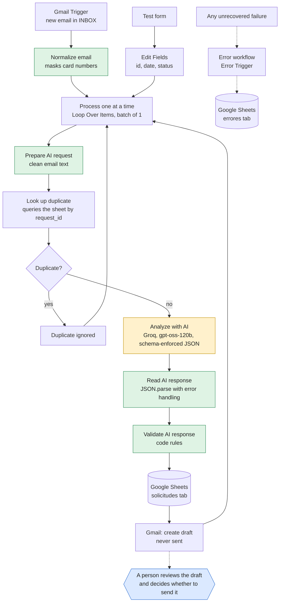

# LeadFlow AI architecture

This document describes how the workflow works and why the design decisions were made. [Versión en español](arquitectura.md).

## Diagram

Legend: orange is the step that uses the language model. Green is custom code, which validates and does not depend on the AI. Blue is the human decision.

The node, tab and status names are in Spanish because the project was built in Spanish. The table below gives the name each node has in the workflow, so you can match them with what you see in n8n.

## Components

| Component | Node in the workflow | Function |
|---|---|---|
| Gmail Trigger | `Gmail Trigger` | Polls the inbox every minute. Filters by the `INBOX` label and by sender, so it does not process its own drafts. |
| Normalize email | `Normalizar correo` | Converts each email to a common format (`request_id`, `Nombre`, `Email`, `Asunto`, `Mensaje`) and masks sequences of 13 to 19 digits. It processes every email in a batch. |
| Process one at a time | `Procesar de uno en uno` | `Loop Over Items` with a batch size of 1. Each email goes through the whole chain separately. |
| Prepare AI request | `Preparar petición IA` | Builds the clean text that is sent to the model. |
| Look up duplicate | `Buscar duplicado` | Looks for the `request_id` (the Gmail ID of the email) in the sheet. `Always Output Data` is on so the workflow keeps going when there is no match. |
| Duplicate? | `¿Duplicado?` / `Duplicado ignorado` | If the email is already logged, the branch ends and the loop continues. |
| Analyze with AI | `Analizar con IA (Groq)` | HTTP call to the model API. It asks for a JSON output that satisfies a schema with 10 fields. |
| Read AI response | `Leer respuesta IA` | Extracts the JSON from the response. If it cannot be read, it sets `parse_error` and the workflow does not break. |
| Validate AI response | `Validar respuesta IA` | Checks the shape of the data and applies its own rules, which do not depend on what the AI thinks. |
| Append or update row | `Append or update row in sheet` | Writes to the sheet with `request_id` as the matching column, so repeating a write does not duplicate rows. It also stores whether human review is required (`human_review_required`, "sí" or "no") and the validation flags (`validation_flags`, separated by " \| "). |
| Create draft | `Create a draft` | Creates a draft in Gmail. The workflow has no node that sends emails. |
| Error workflow | `LeadFlow AI - Errores` | A separate workflow with `Error Trigger`. It logs the node, the message and the execution link in the sheet. |

## Design decisions

**The AI proposes, the code decides.** The AI returns a category, a priority and a draft, but the rules that protect the business are in code:
- A complaint (`reclamacion`) is always high priority and requires review.
- If the draft mentions prices, discounts, warranties, deadlines or opening hours, it is flagged for review.
- If the draft claims that the company offers a product or service ("Yes, we offer…"), it is flagged. A draft that says "a colleague will confirm whether we offer…" is not flagged, because it claims nothing.
- If the email tries to give orders to the AI, it is flagged as a possible manipulation and the priority is set by the code according to the category (quote request and order: medium; information and other: low), so an order like "promise delivery tomorrow" cannot raise it. Complaints stay high.
- If the email contains payment data, it is flagged and the number is masked.

**The email content is data, not an instruction.** The email text goes inside a `<correo>` tag, any tags the sender may include are stripped, and the system instructions state explicitly that what is inside must not be obeyed.

**Nothing is sent automatically.** The workflow only creates drafts. A human reviews them and decides whether to send them.

**A failure does not lose data.** An invalid AI response does not stop the workflow: the row is saved with status `error_validacion`. An API failure is retried three times and, if it persists, it is logged in the `errores` tab.

**The AI provider can be swapped.** Only the call node has to change. `Leer respuesta IA` understands the Gemini format and that of OpenAI-compatible APIs. The project started on Gemini and moved to Groq when the free daily quota ran out. The Gemini node is still on the canvas, disconnected, as an alternative; it keeps the earlier version of the prompt (rules 1 to 8), without rules 9 to 12 of the Groq node.

## Request statuses

| Status | Meaning |
|---|---|
| `pendiente_revision` | The AI did not detect missing information. Human review anyway. |
| `incompleta` | Details are missing that the customer can provide. |
| `error_validacion` | The AI response did not pass validation. |

The status only says whether details are missing. To know which requests to look at first, use `human_review_required` and `validation_flags`.

## Known limitations

- If one email fails inside a batch, the following ones in that batch are not processed. The error is logged and the execution has to be retried by hand.
- The validation filters are regular expressions. They detect the known cases, not every possible one. That is why human review remains essential.
- The "we offer a product or service" flag detects explicit claims, not implicit ones such as "thank you for your interest in our custom T-shirts". Every information query requires human review for this reason.
- The free tiers of AI APIs have daily and per-minute limits, and may use the data sent to improve their models. That is why the tests use only fictional data.
- In the tests, all emails come from the same account, so the sender and, sometimes, the company the AI detects show up under the test account's name.
