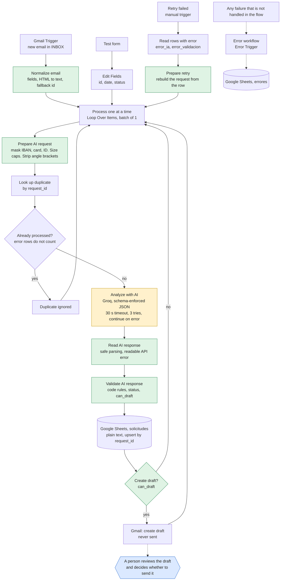

# LeadFlow AI architecture

How the workflow works and why it is built this way. [Versión en español](arquitectura.md).

## Data flow

Orange: the only step that uses a language model. Green: custom code, which validates and does not depend on the AI. Blue: the human decision.

The node, tab and status names are in Spanish because the project was built in Spanish. The tables below give the name each node has in the workflow, so you can match them with what you see in n8n.

## Step by step

1. **Entry.** Three ways in, all ending in the same loop: the Gmail Trigger (production), a test form (`On form submission`) and the manual `Reintentar fallidos` trigger, which feeds rows that failed before.
2. **Process one at a time.** `Loop Over Items` with batch size 1. Each email goes through the whole chain by itself, so one bad email cannot take the others with it.
3. **Prepare the AI request.** The only place where the email is cleaned. Every entry point and every retry passes through it. It removes control characters, caps the length, masks card numbers, IBANs and DNI/NIE numbers, strips `<` and `>` from the model-bound text, and flags anything unusual (empty subject, empty body, invalid sender, cut email).
4. **Duplicate check.** The sheet is queried by `request_id` (the Gmail message id). A row that already exists with a normal status ends the branch. A row with a status starting with `error_` does not count as processed, so a failed email can be retried.
5. **Ask the model.** HTTP call to an OpenAI-compatible API (Groq). The answer must be JSON that satisfies a schema. Timeout 30 s, three tries, and on persistent failure the node **continues** with an error item instead of stopping the execution.
6. **Read the answer.** Parses the JSON safely. A non-object or incomplete answer becomes a parse error. A failed API call becomes a readable reason (HTTP code and message, with anything that looks like a key removed, at most 300 characters). The original email fields always win over what the model returns.
7. **Validate.** The rules in code (below) set the status, the flags, the priority where needed, whether human review is mandatory and `can_draft`.
8. **Write the row.** Google Sheets upsert keyed by `request_id`, stored as plain text so email content cannot become a formula.
9. **Gate and draft.** If `can_draft` is true, Gmail receives a draft addressed to the sender. If not, the item goes back to the loop. The workflow has no node that sends, replies or forwards.

## Components

| Component | Node in the workflow | Function |
|---|---|---|
| Gmail Trigger | `Gmail Trigger` | Polls the inbox every minute. Filters by the `INBOX` label and by sender, so it does not process its own drafts. |
| Normalize email | `Normalizar correo` | Common format (`request_id`, `Nombre`, `Email`, `Asunto`, `Mensaje`). Converts an HTML-only body to text, gives a fallback id (`sin-id-<hash>`) when Gmail returns none, and processes every email of a batch. |
| Test form | `On form submission` → `Edit Fields` | Entry for testing without Gmail. Sets id, date and initial status. |
| Retry entry | `Reintentar fallidos` → `Leer filas con error` → `Preparar reintento` | Manual trigger. Reads the rows with status `error_ia` or `error_validacion` and rebuilds the request from the stored (already sanitised) fields. |
| Process one at a time | `Procesar de uno en uno` | `Loop Over Items`, batch size 1. |
| Prepare AI request | `Preparar petición IA` | Sanitising and prompt text (see step 3). |
| Look up duplicate | `Buscar duplicado` | Sheet lookup by `request_id`. `Always Output Data` is on so the flow continues when there is no match. |
| Duplicate? | `¿Duplicado?` / `Duplicado ignorado` | Boolean test: the row exists and its status does not start with `error_`. |
| Analyze with AI | `Analizar con IA (Groq)` | HTTP call with timeout, retries and continue-on-error. A second node, `Analizar con IA` (Gemini), is disconnected and keeps an earlier prompt. |
| Read AI response | `Leer respuesta IA` | Safe parsing; understands the Gemini and the OpenAI-compatible shapes. |
| Validate AI response | `Validar respuesta IA` | Shape checks plus the business rules. |
| Append or update row | `Append or update row in sheet` | Upsert by `request_id`, plain text. |
| Draft gate | `¿Crear borrador?` | Passes only when `can_draft` is true. |
| Create draft | `Create a draft` | Gmail draft. Never sent. |
| Error workflow | `LeadFlow AI - Errores` | Separate workflow with `Error Trigger`. Logs the workflow, the node, the message and the execution link in the `errores` tab (plain text as well). |

## Design decisions

**The AI proposes, the code decides.** The model returns a category, a priority, a summary and a draft. The rules that protect the business are in code and do not depend on what the model says:

- A complaint (`reclamacion`) is always high priority and requires review.
- Information queries always require review, because the model cannot be trusted to know what the company offers.
- A draft that mentions prices, discounts, warranties, deadlines, opening hours or availability is flagged. A draft that claims the company offers something ("Yes, we offer…") is flagged, but "a colleague will confirm whether we offer…" is not, because it claims nothing.
- A draft that contains a link or an email address is flagged.
- If the email gives orders to the AI, it is flagged as a possible manipulation and the **code** sets the priority from the category, so "promise delivery tomorrow" cannot raise it.
- Payment data and ID numbers are masked before anything else sees them, and the email is flagged.
- An empty draft, or no valid recipient, means no draft is created.

**The email is data, not instructions.** It goes inside a `<correo>` block, every `<` and `>` is removed from it so nothing can close the block or open another, and the system prompt says explicitly that the content must not be obeyed. This reduces prompt injection; it does not eliminate it, which is why the code rules above exist.

**Data minimisation.** IBANs, card numbers and DNI/NIE numbers are masked before they reach the model, the sheet or the draft. The sender address is kept because the draft needs it.

**Nothing is sent automatically.** The workflow only creates drafts. A test fails if any Gmail node can send, reply or forward.

**A failure should not lose an email.** The AI step cannot stop a batch: after three tries the email is saved with status `error_ia` and the reason, and the loop goes on. Those rows can be retried with `Reintentar fallidos`. An invalid model answer is saved as `error_validacion`. Failures of Google Sheets or Gmail stop the execution, are logged by the error workflow and are retried from the n8n interface.

**Repeating a run should change nothing.** The duplicate lookup comes first, and the write is an upsert. Running the same email twice leaves one row, one draft and one model call.

**Spreadsheet cells are plain text.** Both Sheets writes use the `RAW` cell format. With the default format a subject starting with `=` is stored as a formula.

**The provider can be swapped.** Only the call node has to change. The project started on Gemini and moved to Groq when the free daily quota ran out.

## Request statuses

| Status | Meaning | Draft created |
|---|---|---|
| `pendiente_revision` | The AI found nothing missing. A person reviews anyway. | Yes |
| `incompleta` | Details are missing that the customer can provide, or the input had a problem. | Yes, asking for them |
| `error_validacion` | The AI answer did not pass validation. The reason is in `validation_flags`. | No |
| `error_ia` | The AI call failed after its retries. The reason is in `validation_flags`. | No |

The status says what happened to the request. To decide what a person should look at first, use `human_review_required` and `validation_flags`.

## What happens when something fails

| Failure | What the workflow does | How to recover |
|---|---|---|
| The AI API fails or times out | 3 tries, then the row is saved as `error_ia` with the reason. The batch continues. | Run `Reintentar fallidos`. |
| The AI returns something invalid | Row saved as `error_validacion` with the reason. No draft. | Run `Reintentar fallidos`, or handle it by hand. |
| Google Sheets fails | The lookup is retried 3 times; a failed write stops the execution. The error workflow logs it. | Retry the execution in n8n. |
| Gmail fails to create the draft | The row already exists; the execution stops and is logged. | Retry the execution: the row is updated, not duplicated, and the draft is created. |
| The same email arrives twice | Ignored at the duplicate check. | Nothing to do. |
| Two runs process the same email at once | One row, but **two drafts** (known limitation). | Delete the extra draft. Do not execute manually while the workflow is published. |

More in [KNOWN_LIMITATIONS.md](KNOWN_LIMITATIONS.md). How each part was checked is in [TEST_REPORT.md](TEST_REPORT.md) and [AUDIT.md](AUDIT.md).
