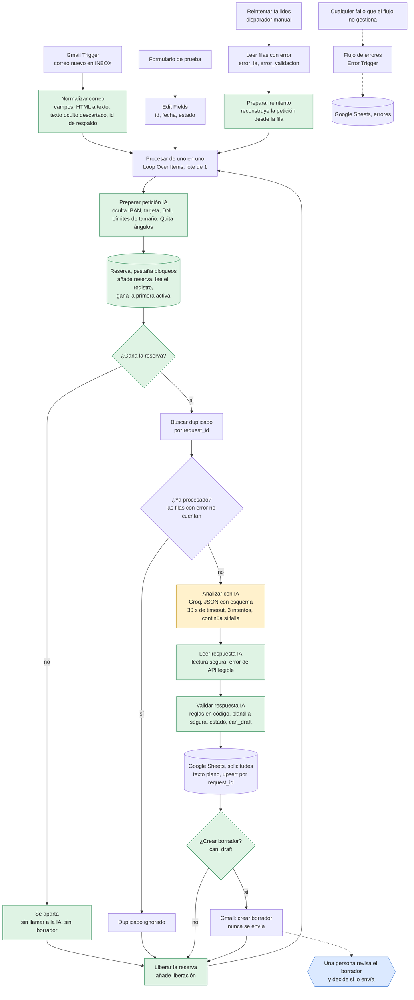

# Arquitectura de LeadFlow AI

Cómo funciona el flujo y por qué está construido así. [English version](architecture.md).

## Flujo de datos

Naranja: el único paso que usa un modelo de lenguaje. Verde: código propio, que valida y no depende de la IA. Azul: la decisión humana.

## Paso a paso

1. **Entrada.** Tres vías, todas acaban en el mismo bucle: el Gmail Trigger (producción), un formulario de prueba (`On form submission`) y el disparador manual `Reintentar fallidos`, que reinyecta filas que fallaron antes.
2. **Procesar de uno en uno.** `Loop Over Items` con lote de 1. Cada correo recorre la cadena entera por separado, así que un correo problemático no arrastra a los demás.
3. **Preparar la petición a la IA.** Es el único sitio donde se limpia el correo, y pasan por él todas las entradas y todos los reintentos. Quita caracteres de control, invisibles y de dirección de escritura, normaliza las letras parecidas y de ancho completo, limita la longitud, oculta números de tarjeta, IBAN y DNI/NIE, elimina `<` y `>` del texto que va al modelo, comprueba que el remitente sea una única dirección limpia y marca lo raro (asunto vacío, cuerpo vacío, remitente inválido, correo recortado, órdenes dirigidas a la IA).
4. **Reservar el correo.** Antes de que nada más toque la hoja o el modelo, la ejecución añade una *reserva* para este `request_id` a la pestaña `bloqueos`, vuelve a leer la pestaña y solo gana si su reserva es la primera activa por orden de fila (activa: no liberada y de menos de 10 minutos). La ejecución que pierde se detiene aquí: sin llamada al modelo y sin borrador. Una ejecución que no encuentra su propia reserva al releer falla con un error en vez de seguir. Toda salida de la rama añade una liberación.
5. **Comprobar duplicados.** Se consulta la hoja por `request_id` (el identificador del mensaje en Gmail). Si ya existe una fila con un estado normal, la rama termina. Una fila con estado que empieza por `error_` no cuenta como procesada, para que un correo fallido se pueda reintentar.
6. **Preguntar al modelo.** Llamada HTTP a una API compatible con OpenAI (Groq). La respuesta debe ser un JSON que cumpla un esquema. Timeout de 30 s, tres intentos y, si el fallo persiste, el nodo **continúa** con un elemento de error en vez de parar la ejecución.
7. **Leer la respuesta.** Interpreta el JSON con control de errores. Una respuesta que no es un objeto o está incompleta se trata como error de lectura. Una llamada fallida se convierte en un motivo legible (código HTTP y mensaje, sin nada que parezca una clave, 300 caracteres como máximo). Los datos originales del correo siempre prevalecen sobre lo que devuelva el modelo.
8. **Validar.** Las reglas en código (abajo) fijan el estado, los avisos, la prioridad cuando hace falta, si la revisión humana es obligatoria y `can_draft`. Si el borrador muestra cualquier señal de riesgo, se sustituye por una respuesta de cortesía fija.
9. **Escribir la fila.** Upsert en Google Sheets por `request_id`, como texto plano, para que el contenido de un correo no pueda convertirse en fórmula. La fila tiene las 17 columnas, incluidos los datos del cliente que extrajo el modelo.
10. **Puerta y borrador.** Si `can_draft` es verdadero, Gmail recibe un borrador dirigido al remitente. Si no, el elemento sigue su camino. El flujo no tiene ningún nodo que envíe, responda o reenvíe.
11. **Liberar la reserva.** Todos los caminos (borrador creado, sin borrador, duplicado, reserva perdida) acaban en `Liberar reserva`, que añade una liberación y vuelve al bucle.

## Componentes

| Componente | Nodo en el workflow | Función |
|---|---|---|
| Gmail Trigger | `Gmail Trigger` | Sondea la bandeja cada minuto. Filtra por etiqueta `INBOX` y por remitente, para no procesar sus propios borradores. |
| Normalizar correo | `Normalizar correo` | Formato común (`request_id`, `Nombre`, `Email`, `Asunto`, `Mensaje`). Convierte a texto un cuerpo solo HTML (descartando comentarios, scripts, estilos y elementos ocultos con CSS, con un presupuesto de trabajo), da un id de respaldo (`sin-id-<hash>`) si Gmail no devuelve ninguno y procesa todos los correos de una tanda. |
| Formulario de prueba | `On form submission` → `Edit Fields` | Entrada para probar sin Gmail. Fija id, fecha y estado inicial. |
| Entrada de reintento | `Reintentar fallidos` → `Leer filas con error` → `Preparar reintento` | Disparador manual. Lee las filas con estado `error_ia` o `error_validacion` y reconstruye la petición desde los campos guardados (ya limpios). |
| Procesar de uno en uno | `Procesar de uno en uno` | `Loop Over Items`, lote de 1. |
| Preparar petición IA | `Preparar petición IA` | Limpieza y texto del prompt (paso 3). |
| Reserva | `Preparar reserva` → `Crear reserva` → `Leer reservas` → `Decidir reserva` → `¿Gana la reserva?` / `Reserva perdida` | Registro de reservas solo de añadir, en la pestaña `bloqueos` (paso 4). Una reserva perdida termina en `Reserva perdida`. `Crear reserva` y `Leer reservas` reintentan 3 veces. |
| Liberar reserva | `Liberar reserva` | Añade el evento de liberación; toda salida de la rama pasa por él. |
| Buscar duplicado | `Buscar duplicado` | Consulta la hoja por `request_id`. `Always Output Data` activado para que el flujo siga cuando no hay coincidencia. |
| ¿Duplicado? | `¿Duplicado?` / `Duplicado ignorado` | Comprobación booleana: la fila existe y su estado no empieza por `error_`. |
| Analizar con IA | `Analizar con IA (Groq)` | Llamada HTTP con timeout, reintentos y «continuar si falla». |
| Leer respuesta IA | `Leer respuesta IA` | Lectura segura; entiende el formato compatible con OpenAI y el de Gemini, así que el proveedor se cambia editando solo el nodo de llamada. |
| Validar respuesta IA | `Validar respuesta IA` | Comprobaciones de forma, reglas de negocio y plantilla segura. |
| Append or update row | `Append or update row in sheet` | Upsert por `request_id`, texto plano, 17 columnas. |
| Puerta del borrador | `¿Crear borrador?` | Deja pasar solo si `can_draft` es verdadero. |
| Crear borrador | `Create a draft` | Borrador en Gmail. Nunca se envía. |
| Flujo de errores | `LeadFlow AI - Errores` | Workflow aparte con `Error Trigger`. Anota el workflow, el nodo, el mensaje (con las direcciones de correo ocultas y como máximo 300 caracteres) y el enlace de la ejecución en la pestaña `errores` (también como texto plano). |

## Decisiones de diseño

**La IA propone, el código decide.** El modelo devuelve categoría, prioridad, resumen y borrador. Las reglas que protegen al negocio están en código y no dependen de lo que diga el modelo:

- Una reclamación (`reclamacion`) siempre es prioridad alta y requiere revisión.
- Las consultas de información siempre requieren revisión, porque no se puede confiar en que el modelo sepa lo que ofrece la empresa.
- Un borrador que menciona precios, descuentos, garantías, plazos, horarios o disponibilidad se marca. Uno que afirma que la empresa ofrece algo («Sí, ofrecemos…») se marca, pero «un compañero le confirmará si ofrecemos…» no, porque no afirma nada.
- Un borrador que contiene un enlace o una dirección de correo se marca.
- Un borrador que contiene una cifra que no aparece en el correo, una promesa o confirmación, hablar de pagos o datos internos se marca.
- Cuando salta cualquiera de esos avisos, el borrador se **sustituye** por una respuesta de cortesía fija escrita en el código, y la fila lo indica en `validation_flags`.
- Si el correo da órdenes a la IA, se marca como posible manipulación y **el código** fija la prioridad según la categoría, para que «promete entrega mañana» no pueda subirla.
- Los datos de pago y los números de documento se ocultan antes de que nada más los vea, y el correo se marca.
- Un borrador vacío, o un destinatario no válido, significa que no se crea borrador.

**El correo es dato, no instrucciones.** Va dentro de un bloque `<correo>`, se le quitan todos los `<` y `>` para que nada pueda cerrar el bloque ni abrir otro, y el prompt de sistema dice explícitamente que no se obedezca su contenido. Antes de aplicar las reglas se quitan los caracteres invisibles y se normalizan las letras parecidas, así que los trucos con espacios o con letras de otros alfabetos no esconden una orden. Esto reduce la inyección de instrucciones, no la elimina; por eso existen las reglas en código de arriba.

**Minimización de datos.** Los IBAN, números de tarjeta y DNI/NIE se ocultan antes de llegar al modelo, a la hoja o al borrador. La dirección del remitente se conserva porque el borrador la necesita.

**No se envía nada automáticamente.** El flujo solo crea borradores. Una prueba falla si algún nodo de Gmail puede enviar, responder o reenviar.

**Un fallo no debería perder un correo.** El paso de IA no puede parar una tanda: tras tres intentos el correo se guarda con estado `error_ia` y el motivo, y el bucle sigue. Esas filas se pueden reintentar con `Reintentar fallidos`. Una respuesta inválida del modelo se guarda como `error_validacion`. Los fallos de Google Sheets o Gmail paran la ejecución, los registra el flujo de errores y se reintentan desde la interfaz de n8n.

**Repetir una ejecución no debería cambiar nada.** La reserva y la búsqueda de duplicados van primero y la escritura es un upsert. Procesar el mismo correo dos veces, incluso en el mismo instante, deja una fila, un borrador y una llamada al modelo.

**Por qué un registro de reservas solo de añadir.** Google Sheets no tiene un «crear si no existe» atómico. Dos ejecuciones que leyeran antes de que ninguna escribiera verían las dos «libre». Por eso cada ejecución primero *añade* una reserva, después lee todo el registro y gana la primera reserva activa por orden de fila; la hoja ordena las altas de forma total, así que las dos ejecuciones coinciden en quién gana. El coste son unas seis llamadas a Sheets por correo y una pestaña que crece (ver [KNOWN_LIMITATIONS.md](KNOWN_LIMITATIONS.md), en inglés). La pestaña de reservas guarda solo identificadores y horas, nunca el contenido de un correo.

**Datos que conserva el propio n8n.** Las ejecuciones correctas y las manuales no guardan datos, y tampoco se guarda el progreso de una ejecución, así que el contenido de un correo no queda en el historial de ejecuciones de n8n. Las ejecuciones fallidas sí se conservan, a propósito, para diagnosticarlas y reintentarlas. Ningún nodo escribe en la consola y el registro de errores oculta las direcciones de correo y limita el mensaje. La retención, quién puede abrir las ejecuciones y la ocultación de datos de ejecución son ajustes de la instancia, listados en las limitaciones.

**Las celdas de la hoja son texto plano.** Las dos escrituras en Sheets usan el formato `RAW`. Con el formato por defecto, un asunto que empiece por `=` se guarda como fórmula.

**El proveedor se puede cambiar.** Solo hay que cambiar el nodo de llamada (el lector de la respuesta acepta los dos formatos). El proyecto empezó con Gemini y pasó a Groq cuando se agotó la cuota diaria gratuita.

## Estados de una solicitud

| Estado | Significado | ¿Se crea borrador? |
|---|---|---|
| `pendiente_revision` | La IA no encontró nada que falte. Una persona revisa igualmente. | Sí |
| `incompleta` | Faltan datos que el cliente puede aportar, o la entrada tenía algún problema. | Sí, pidiéndolos |
| `error_validacion` | La respuesta de la IA no pasó la validación. El motivo está en `validation_flags`. | No |
| `error_ia` | La llamada a la IA falló tras los reintentos. El motivo está en `validation_flags`. | No |

El estado dice qué le pasó a la solicitud. Para decidir qué debe mirar antes una persona, se usan `human_review_required` y `validation_flags`.

## Qué pasa cuando algo falla

| Fallo | Qué hace el flujo | Cómo recuperarlo |
|---|---|---|
| La API de IA falla o tarda demasiado | 3 intentos y la fila se guarda como `error_ia` con el motivo. La tanda continúa. | Ejecutar `Reintentar fallidos`. |
| La IA devuelve algo inválido | Fila guardada como `error_validacion` con el motivo. Sin borrador. | Ejecutar `Reintentar fallidos` o gestionarlo a mano. |
| Falla Google Sheets | La búsqueda se reintenta 3 veces; una escritura fallida para la ejecución. El flujo de errores lo anota. | Reintentar la ejecución en n8n. |
| Gmail no consigue crear el borrador | La fila ya existe; la ejecución se para y queda anotada. | Reintentar la ejecución: la fila se actualiza, no se duplica, y se crea el borrador. |
| El mismo correo llega dos veces | Se ignora en la comprobación de duplicados. | Nada que hacer. |
| Dos ejecuciones procesan el mismo correo a la vez | La reserva deja pasar a una: una fila y un borrador. La otra se detiene antes de llamar al modelo. | Nada que hacer. |
| Una ejecución se cae mientras tiene la reserva | El correo queda bloqueado hasta 10 minutos, después la reserva caduca. | Reintentar la ejecución fallida (libera la reserva) o esperar. No reanudar una ejecución antigua después de que otra haya tomado el relevo (limitación conocida C12). |
| El registro de reservas no se puede releer, o falta la reserva de la propia ejecución | La ejecución falla con un error en vez de seguir sin protección. | Reintentar la ejecución. |

Más en [KNOWN_LIMITATIONS.md](KNOWN_LIMITATIONS.md) (en inglés). Cómo se comprobó cada parte está en [TEST_REPORT.md](TEST_REPORT.md) y [AUDIT.md](AUDIT.md), también en inglés.
