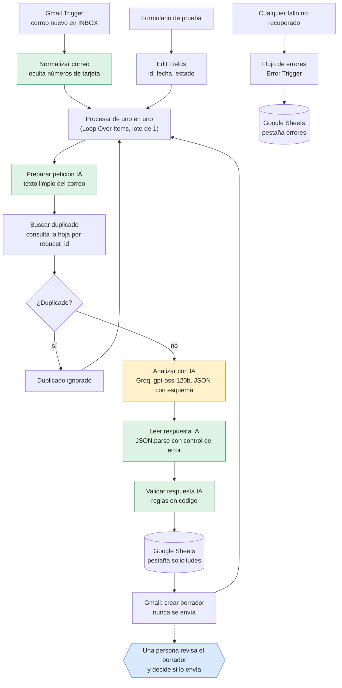

# Arquitectura de LeadFlow AI

Este documento describe cómo funciona el flujo y por qué se tomaron las decisiones de diseño.

## Diagrama

Leyenda: en naranja, el paso que usa el modelo de lenguaje. En verde, los pasos de código propio, que validan y no dependen de la IA. En azul, la decisión humana. Hay una [imagen del diagrama](arquitectura.png) para usarla fuera de GitHub.

## Componentes

| Componente | Función |
|---|---|
| Gmail Trigger | Sondea la bandeja cada minuto. Filtra por etiqueta `INBOX` y por remitente, para no procesar sus propios borradores. |
| Normalizar correo | Convierte cada correo a un formato común (`request_id`, `Nombre`, `Email`, `Asunto`, `Mensaje`) y oculta secuencias de 13 a 19 cifras. Procesa todos los correos de una tanda. |
| Procesar de uno en uno | `Loop Over Items` con lote de 1. Cada correo recorre toda la cadena por separado. |
| Buscar duplicado | Busca el `request_id` (el identificador del correo en Gmail) en la hoja. Con `Always Output Data` activado para que el flujo siga cuando no hay coincidencia. |
| Analizar con IA | Llamada HTTP a la API del modelo. Pide una salida JSON que cumpla un esquema con 10 campos. |
| Leer respuesta IA | Extrae el JSON de la respuesta. Si no es legible, marca `parse_error` y el flujo no se rompe. |
| Validar respuesta IA | Comprueba la forma de los datos y aplica reglas propias que no dependen de lo que opine la IA. |
| Append or update row | Escribe en la hoja con `request_id` como columna de coincidencia, así que repetir una escritura no duplica filas. Guarda también si requiere revisión humana (`human_review_required`, «sí» o «no») y los avisos de validación (`validation_flags`, separados por « \| »). |
| Crear borrador | Crea un borrador en Gmail. El flujo no tiene ningún nodo que envíe correos. |
| Flujo de errores | Workflow aparte con `Error Trigger`. Anota el nodo, el mensaje y el enlace de la ejecución en la hoja. |

## Decisiones de diseño

**La IA propone, el código decide.** La IA devuelve una categoría, una prioridad y un borrador, pero las reglas que protegen al negocio están en código:
- Una reclamación siempre es prioridad alta y revisión obligatoria.
- Si el borrador menciona precios, descuentos, garantías, plazos o horarios, se marca para revisión.
- Si el borrador afirma que la empresa ofrece un producto o servicio («Sí, ofrecemos…»), se marca. Un borrador que dice «un compañero le confirmará si ofrecemos…» no se marca, porque no afirma nada.
- Si el correo intenta dar órdenes a la IA, se marca como posible manipulación y la prioridad la fija el código según la categoría (presupuesto y pedido: media; información y otra: baja), para que una orden como «promete entrega mañana» no pueda subirla. Las reclamaciones siguen siendo alta.
- Si el correo contiene datos de pago, se marca y se oculta el número.

**El contenido del correo es un dato, no una instrucción.** El texto del correo va dentro de una etiqueta `<correo>`, se eliminan las etiquetas que el remitente pudiera incluir, y las instrucciones del sistema dicen expresamente que lo que haya dentro no debe obedecerse.

**Nada se envía solo.** El flujo solo crea borradores. Un humano los revisa y decide si enviarlos.

**Un fallo no pierde datos.** Una respuesta inválida de la IA no detiene el flujo: la fila se guarda con estado `error_validacion`. Un fallo de la API se reintenta tres veces y, si persiste, queda anotado en la pestaña `errores`.

**El proveedor de IA se puede cambiar.** Solo hay que tocar el nodo de la llamada. `Leer respuesta IA` entiende el formato de Gemini y el de las APIs compatibles con OpenAI. El proyecto empezó con Gemini y se pasó a Groq al agotar la cuota diaria gratuita. El nodo de Gemini sigue en el lienzo, sin conectar, como alternativa; conserva la versión anterior del prompt (reglas 1 a 8), sin las reglas 9 a 12 del nodo de Groq.

## Estados de una solicitud

| Estado | Significado |
|---|---|
| `pendiente_revision` | La IA no detectó información que falte. Revisión humana igualmente. |
| `incompleta` | Faltan datos que el cliente puede aportar. |
| `error_validacion` | La respuesta de la IA no pasó la validación. |

El estado solo dice si faltan datos. Para saber qué solicitudes hay que mirar primero, usa `human_review_required` y `validation_flags`.

## Limitaciones conocidas

- Si un correo falla dentro de una tanda, los siguientes de esa tanda no se procesan. El error queda anotado y hay que reintentar la ejecución a mano.
- Los filtros de la validación son expresiones regulares. Detectan los casos conocidos, no todos los posibles. Por eso la revisión humana sigue siendo imprescindible.
- El aviso de «ofrecemos un producto o servicio» detecta afirmaciones explícitas, no implícitas como «gracias por su interés en nuestras camisetas personalizadas». Toda consulta de información exige revisión humana por esta razón.
- Los niveles gratuitos de las APIs de IA tienen límites diarios y por minuto, y pueden usar los datos enviados para mejorar sus modelos. Por eso las pruebas usan solo datos ficticios.
- En las pruebas, todos los correos salen de la misma cuenta, así que el remitente y, a veces, la empresa que detecta la IA aparecen con el nombre de la cuenta de pruebas.
